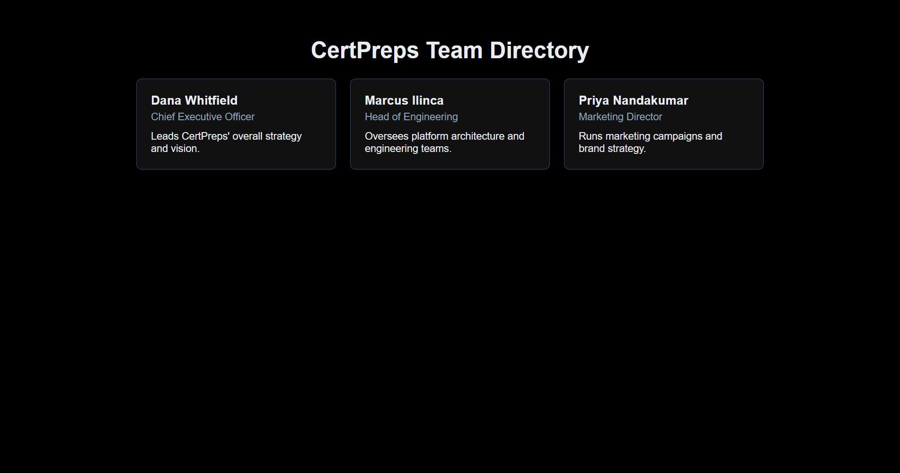
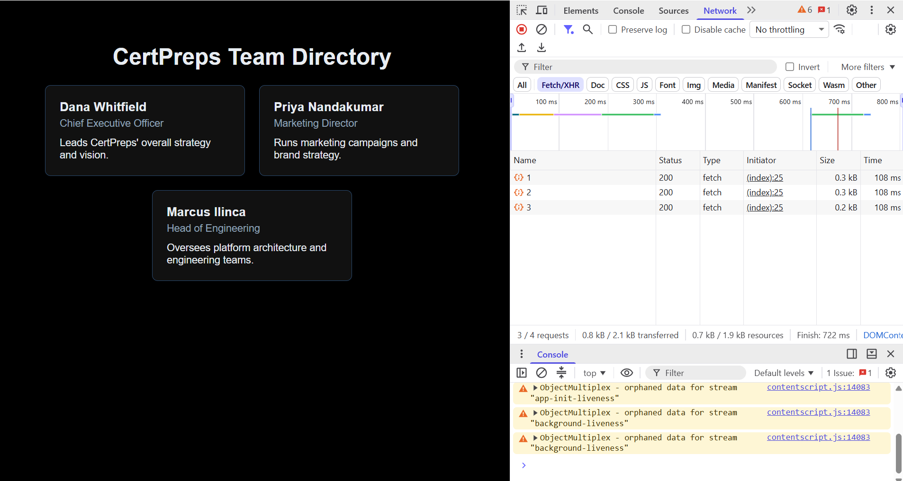
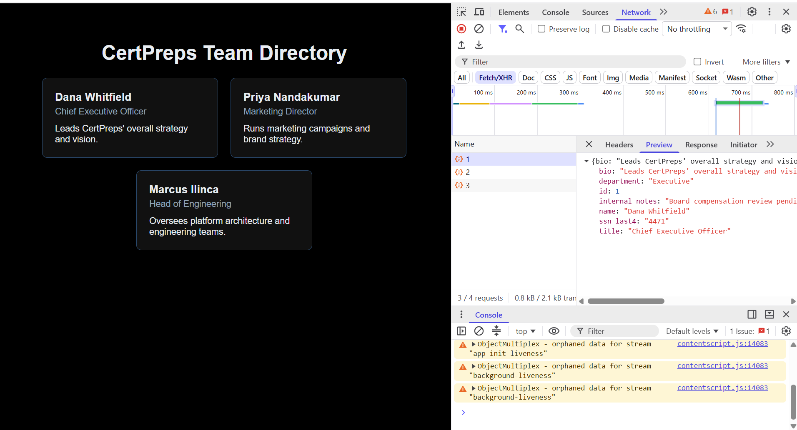

### API Security Lab: Excessive Data Exposure

A browser-based investigation of excessive data exposure in a CertPreps training challenge.

I compared the employee information displayed in a mock Team Directory with the JSON responses received by the browser. The responses included `internal_notes` and `ssn_last4` fields that were not displayed on the profile cards. This demonstrated why omitting information from the page does not protect information already sent to the client.

All employee records and identifier values shown are synthetic data provided for the CertPreps challenge.

### Objectives

- Identify the requests used to populate the directory.
- Inspect the returned JSON using browser Developer Tools.
- Compare the response fields with the information displayed on the page.
- Document the exposure and explain its security implications.
- Recommend server-side controls without claiming to have implemented or tested a fix.

### Lab Environment

| Component | Details |
|---|---|
| Training platform | CertPreps |
| Challenge topic | Excessive Data Exposure |
| Target application | Mock Team Directory |
| Investigation tool | Browser Developer Tools |
| Request filtering | Network panel, Fetch/XHR filter |
| Response inspection | Preview tab |
| Data | Synthetic employee records |

### Investigation

#### 1. Establish What the Page Displays

**Purpose:** Understand the information presented to a directory visitor before inspecting the underlying responses.

The directory displayed three employee profile cards. Each card showed a name, job title and short biography. Internal notes and partial Social Security number fields were not displayed.

*Figure 1: The visible directory presents basic employee profile information. All records are fictional challenge data.*

#### 2. Locate the Requests Supplying the Directory

**Purpose:** Identify the browser requests associated with loading the employee information.

I opened Developer Tools and used the Network panel's Fetch/XHR filter to isolate the relevant requests. The captured list showed three fetch requests, labelled `1`, `2` and `3`, each with an HTTP `200` response.

*Figure 2: The Fetch/XHR-filtered request list shows three requests returning HTTP 200 responses.*

**Interpretation:** A successful response confirms that the request was handled successfully; it does not establish that every returned field is appropriate for the requesting user. Inspecting the response content was necessary to evaluate the exposure.

#### 3. Compare the Response with the Rendered Profile

**Purpose:** Check whether the browser received information beyond what the directory displayed.

I selected an employee request and expanded its JSON response in the Preview tab. Alongside the displayed profile fields, the response contained additional properties, including `internal_notes` and `ssn_last4`.

| Field | Displayed on the profile card? | Present in the inspected response? |
|---|---|---|
| `name` | Yes | Yes |
| `title` | Yes | Yes |
| `bio` | Yes | Yes |
| `department` | No | Yes |
| `id` | No | Yes |
| `internal_notes` | No | Yes |
| `ssn_last4` | No | Yes |

Not every undisplayed field is necessarily sensitive. The key finding was the inclusion of internal notes and a partial personal identifier, rather than simply the presence of additional properties.

*Figure 3: The response includes internal_notes and ssn_last4 even though the profile card displays neither field. The values are synthetic challenge data.*

I also inspected another employee response and observed the same additional field names. This supported the finding across more than one record rather than relying on a single example.

**Result:** Information omitted from the visible page remained accessible through the browser's response inspection tools.

### Finding: Excessive Data Exposure

The application returned more employee information than was needed for the displayed directory. The page presented only selected properties, but the browser still received the additional data.

The observed behaviour illustrates a client-side data exposure problem: controlling what is rendered is not the same as controlling what is disclosed.

No request modification or authentication bypass was needed for the response inspection documented here. The finding concerns the properties returned in the normal directory responses, not evidence that another user's account was compromised.

### Security Implications

In a real application, returning internal notes or partial personal identifiers could disclose information to users who should not receive it. Once the data reaches their browser, hiding it from the page does not prevent inspection.

The observed exposure was limited to the inspected challenge responses. This exercise did not establish the impact on a real organisation or demonstrate access to a wider dataset.

### Recommended Remediation

These are proposed controls, not changes implemented during the challenge:

- **Return only necessary properties:** Use an explicit allow-list of fields required for the directory rather than serialising an entire employee object.
- **Separate public and internal response models:** Use a dedicated Data Transfer Object (DTO) or equivalent response model for directory information.
- **Enforce permissions on the server:** Where sensitive properties are needed for authorised workflows, check access before including them in a response.
- **Do not rely on frontend hiding:** Removing a field from a component or page template does not remove it from a response already delivered to the browser.
- **Test response contents:** Add tests that verify restricted properties are absent from responses intended for directory visitors.

### Results Summary

| Investigation step | Recorded outcome |
|---|---|
| Review the directory | Profile cards displayed names, titles and biographies |
| Locate data requests | Three fetch requests with HTTP 200 responses were visible |
| Inspect returned fields | Responses included internal_notes and ssn_last4 |
| Compare page and response | Additional fields were received but not displayed |
| Review another record | The same additional field names appeared in another employee response |
| Formulate remediation | Server-side response filtering and property access controls recommended; no fix implemented |

### Key Takeaways

- The visible page is not a complete picture of the information an application discloses.
- Browser Developer Tools can reveal unnecessary data in otherwise successful responses.
- Undisplayed fields need to be evaluated for sensitivity and purpose, not assumed to be vulnerabilities solely because they are hidden.
- Data minimisation and access control belong on the server, before a response reaches the client.
- A useful finding distinguishes observed evidence, potential impact and recommended remediation.

### Scope and Limitations

This was an authorised CertPreps learning challenge involving fictional records, not a test against a production employee directory.

The documented work used browser Developer Tools to inspect requests and responses. It does not demonstrate authentication bypass, request tampering, automated enumeration, backend source-code review or a deployed remediation.

The public write-up focuses on the exposure mechanism and does not reproduce the challenge flag.

### Potential Follow-up Work

- Build a small local demonstration comparing an overly broad response with an allow-listed directory response.
- Add automated tests checking that internal properties are excluded.
- Explore how role-based property access should be enforced and tested on the server.
